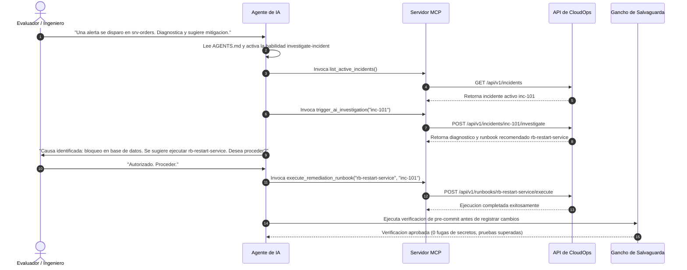

# Documentacion del Paquete de Extension de Agentes (Modulo 5)

## 1. Descripcion General

El **Paquete de Extension de Agentes** de este proyecto permite que asistentes de codigo y agentes autonomos colaboren dentro del ciclo operativo y de desarrollo de software de forma controlada y disciplinada.

En lugar de delegar permisos irrestrictos o utilizar instrucciones aisladas, esta arquitectura provee:
1. **Instrucciones de Contexto Duradero:** Definidas en [AGENTS.md](../AGENTS.md) con especificaciones de arquitectura, directrices de diseno y comandos de verificacion.
2. **Procedimiento Operativo Reutilizable (Skill):** En [agent-capabilities/skills/investigate-incident/SKILL.md](../agent-capabilities/skills/investigate-incident/SKILL.md), estructurando el paso a paso del triaje de incidentes.
3. **Subagente Especializado:** Definido en [agent-capabilities/subagents/sre-responder.md](../agent-capabilities/subagents/sre-responder.md), acotando la responsabilidad a tareas operativas de guardia.
4. **Servidor Model Context Protocol (MCP):** Implementado en [mcp-server/server.py](../mcp-server/server.py), proveyendo cuatro herramientas especializadas accesibles via protocolo estandar.
5. **Mecanismo de Salvaguarda (Guardrail Hook):** Provisto en [agent-hooks/pre-commit-check.sh](../agent-hooks/pre-commit-check.sh), impidiendo fugas involuntarias de credenciales y desalineaciones de esquema.
6. **Matriz de Privilegios Minimos:** Especificada en [docs/permissions.md](permissions.md), delimitando que operaciones requieren autorizacion humana obligatoria.

---

## 2. Guion de Demostracion (Flujo de Ejecucion Paso a Paso)

1. **Paso 1:** El agente lee `AGENTS.md` para asimilar la estructura y lineamientos del repositorio.
2. **Paso 2:** El agente carga la habilidad `investigate-incident`.
3. **Paso 3:** El agente consulta las herramientas del servidor MCP para obtener el inventario de incidentes y la telemetria actual.
4. **Paso 4:** El agente activa el analisis de causas raiz mediante el endpoint de diagnostico.
5. **Paso 5:** El agente solicita autorizacion humana antes de despachar acciones de recuperacion con impacto sobre el servicio.
6. **Paso 6:** El mecanismo de salvaguarda valida que no se introduzcan regresiones de seguridad ni credenciales expuestas.
