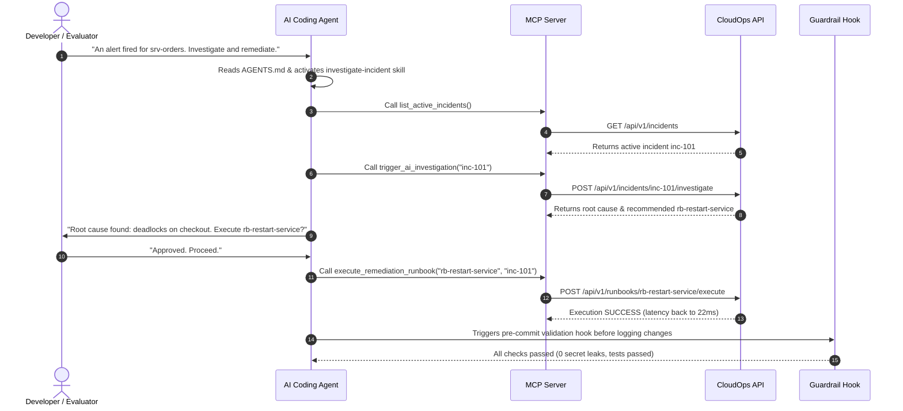

# Agent Extension Pack Documentation

## Overview

The **CloudOps Commander Agent Extension Pack** integrates modern coding assistants and autonomous agents into the DevOps and incident management lifecycle.

Rather than giving an AI agent unrestricted access or relying on generic prompts, this extension pack provides:
1. **Durable Instructions:** [AGENTS.md](../AGENTS.md) defining boundaries, testing procedures, and architecture.
2. **Reusable Workflow (Skill):** `agent-capabilities/skills/investigate-incident/SKILL.md` defining how to systematically triage alerts.
3. **Specialized Subagent:** `agent-capabilities/subagents/sre-responder.md` providing a focused role for incident diagnosis.
4. **Tool Access (MCP Server):** `mcp-server/server.py` exposing four scoped operations.
5. **Guardrail Hook:** `agent-hooks/pre-commit-check.sh` preventing secrets leakage and schema drifts.
6. **Least Privilege Matrix:** `docs/permissions.md` governing read vs execute authority.

---

## Demo Script (End-to-End Workflow)

Follow this 6-step workflow to demonstrate the Agent Extension Pack:

1. **Step 1:** The agent reads `AGENTS.md` to identify the system conventions.
2. **Step 2:** The agent invokes `investigate-incident` skill.
3. **Step 3:** The agent queries `mcp-server` to fetch the telemetry and active incidents.
4. **Step 4:** The agent triggers the AI investigation endpoint to diagnose the root cause.
5. **Step 5:** The agent asks for human-in-the-loop confirmation before running the remediation runbook.
6. **Step 6:** The guardrail hook verifies that the remediation logged is safe and leaves no credential leaks.
